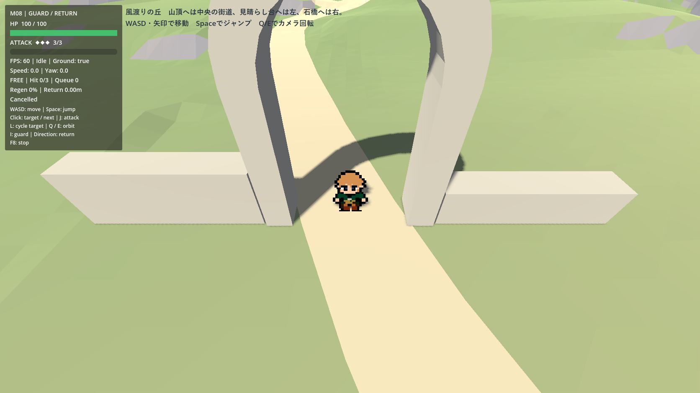
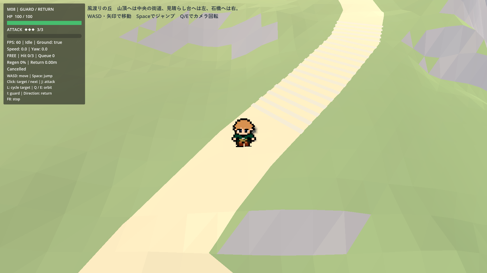
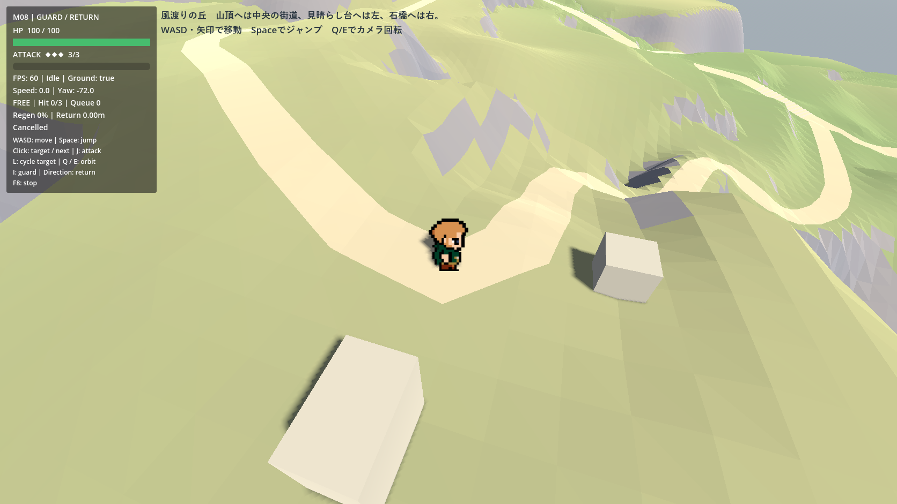
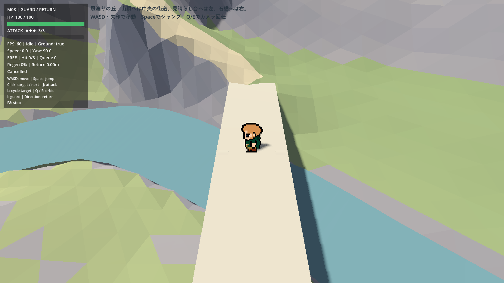
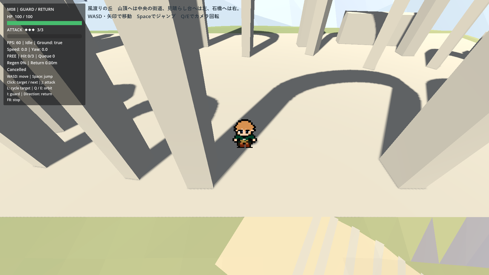
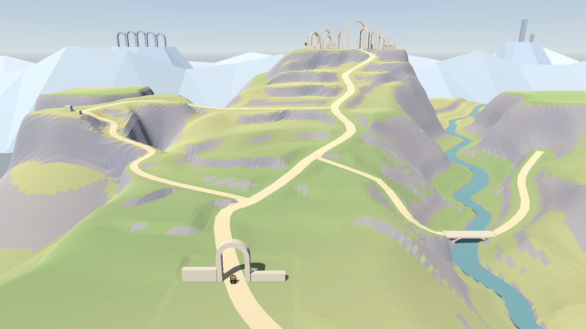

# M10 工程02　風渡りの丘の探索・衝突判定

2026-11-07着手、11-08検証。工程01の構図はユーザー承認済み。工程02はユーザーのF6受入待ち。比較の基準は開始時の `654c136`。[工程01の承認構図・監査](m10_rebuild_stage01_audit.md)

## F6で歩く

Godotで [playground.tscn](../scenes/maps/wind_hills_rebuild/playground.tscn) を開きF6。WASD／矢印で移動、Spaceでジャンプ、Q/Eで回転する。既存の攻撃はJ／左クリック、防御はI／右クリック、対象切替はL。フィールドの敵は0体。

1. 門をくぐり、左の分岐を通過して中央の蛇行街道を登る。5か所の石段を通り、山頂広場のアーチの間で折り返す。下りの最後に門へ戻る。
2. 門から最初の分岐を左へ。見晴らし台の幅を使って立ち位置を変え、Q/Eで中央の丘を見渡す。奥の支道をたどって主街道に再合流する。
3. 中腹の分岐から右へ下り、橋を渡って対岸の道へ。帰りに橋から川へ飛び降り、直近の安全地点で移動・ジャンプを再開する。

確認したい操作感は、坂での停止と再発進、広場から街道に下る瞬間、細い高台の道、橋の両端、門や柱が手前に来たときの見やすさ。正式な工程02受入はユーザーのF6確認待ち。

## 既存主人公と地形の接続

既存Playerは、速度5m/s、加速22m/s²、減速30m/s²、重力20m/s²、ジャンプ初速7m/s、空中制御0.7。高さ1.8m・半径0.3mのカプセルで `move_and_slide()` を使う。上方向はY、床の上限角40°、床への吸着0.30m、斜面での停止・定速移動は有効。物理60Hz。主人公はlayer 2／mask 1、静的地形はlayer 1／mask 0、既存カメラの地形マスクは1。48pxスプライトの表示倍率と主人公Resourceは従来どおり。

- **草地・崖・街道**　探索シーンでは既存484区画に1個ずつ静的な三角形衝突を生成する。各区画の表示メッシュから直接作るため格子の対角線・頂点・崖の形は一致する。道は地形面の約2.6cm上、階段の目印は約7.1cm上に描かれ、物理面は下の連続斜面。入口の仮床を廃止した。
- **橋・建造物**　橋面は17.25×4.13m、厚さ0.75mの閉じた箱。側面・下面も当たり、橋のアーチと両岸の道がつながる。門、柱、壁は箱、アーチ曲面は表示形状から作る。建造物の衝突は56個。山頂の薄い床石は支持地形へ3cmを重ねて表示する。フィールド全体で静的形状540個。遠景の遺構とレビュー専用シーンの衝突は0個。
- **遮蔽**　衝突体ごとに対応する地形区画または建造物の表示面を所有する。既存カメラは視線を遮った個々の面をフェード・復元する。通常カメラの俯角−45°、距離10m、カメラ相対移動と既存の追従を使用する。
- **変更した坂**　工程01の中心線最大勾配は主街道30.7°、左28.0°、川34.5°。初回の実歩行で、広場からの下りのワールド座標 (39.23, 44.12, −178.47) 付近から13物理フレームの離床を再現した。街道が広場の直線的な縁へ斜めに接するため、進行方向の勾配だけでは横断方向を含む床の傾きを捉え切れなかった。最後の坂の高い部分を最大1.65m持ち上げて広場の少し手前で水平に戻した。門・分岐・橋・山頂・街道の平面配置と広場の標高45mを保った。
- **見晴らし台**　実描画の進入テストで (−80.26, 18.53, −83.80) 付近の石に接触した。進入側の石を道の南側へ移し、2個とも実地形へ据えた。中心半径2.63mを平坦にし、半径9mまでを既存の斜面へなじませた。高台内で約6m歩き回ってから主街道へ合流できる。
- **最終の勾配**　実Playerで通れた中間版でも、山頂手前 (X=48.26, Z=−170.82) 付近に38.3°の短い坂が残った。上りを少し手前から分散させ、工程01の設計目安35°以内に戻した。地形メッシュ上の中心線最大は主街道32.47°・左28.94°・川34.48°、検査1,251点で路面欠落0。広場・橋面の接続を含む既存の地形10項目も合格。

## 落下と復帰

入口・中腹・見晴らし台・山頂・橋手前・対岸・川支道終端の7候補について、地形生成後の実空間に床レイを当て、主人公の登坂上限と実カプセルの空きを確認する。通過地点として採用するのは地上・非戦闘で半径2.5m以内に入った候補だけ。シーンを出ると記録は消える。

水面に足が沈んだ場合、マップ外へ落ちた場合、地表の大幅な下抜けや世界下限を検出した場合は、最後に通った安全地点へ移る。支持された低地や通常の段差下ではそのまま探索できる。復帰は既存 `Player.reset_motion()` と `CameraRig.snap_to_target()` を使用し、戦闘動作・入力予約・速度・ジャンプ受付・カメラ固定を解く。押したままの入力は既存の再受付規則に従う。

## 検証方法

実装は[地形と静的衝突](../scripts/maps/wind_hills_rebuild/field.gd)と[探索シーンの復帰処理](../scripts/maps/wind_hills_rebuild/playground.gd)。検証には[実Playerによる試走](../tests/m10_rebuild_exploration.gd)と[再実行用のコマンド](../tools/validate_m10_rebuild.ps1)を使う。

- 新マップの本番シーンを起動し、同じ実Playerへ通常のInputMap移動入力を送る。門→山頂→門、左分岐→高台内の往復→合流、主街道→橋→対岸→復路を**一本の連続走行**で検査する。各通過点への到達・意図しない復帰・接地と、山頂などの実高度を確認する。局所のジャンプ、壁・落下、定点計測の開始位置だけを個別に準備する。
- 平地・坂・石段・段丘の縁でジャンプして着地後に歩く。門の柱へ歩いて衝突、低い壁から自然落下、橋からの入水、場外復帰を検査。橋面の下面・側面には物理レイを当てる。門ではQ/E各360°、遮蔽物のフェードと描画継続、回転後の画面前方入力と実移動の一致を検査する。
- 実機計測はGodot 4.7.2 stable、GeForce GTX 1080、OpenGL Compatibility、1672×941。移動中のフレーム間隔は単調時計、Physics時間はGodotの `Performance.TIME_PHYSICS_PROCESS` モニターをサンプリングする。FPS上限と物理60Hzを分けて記録する。Physics最大はモニターで観測した最大値。
- 再実行はプロジェクト直下で `.\tools\validate_m10_rebuild.ps1 -Mode exploration`（高速物理）、`exploration60`／`exploration30`（全線と描画）、`exploration_perf60`／`exploration_perf30`（定点のみ）、`exploration_regression`（既存系統）。工程01のPNG・JSONは履歴として保存し、以前の構図検査を再実行した出力は `.godot/` に書く。

## ルート・衝突・回帰の結果

|実際に歩いた区間|確認した内容|
|---|---|
|門→中腹→山頂→門|上り約223m、下り約222m。中腹で一旦停止して再出発し、山頂Y=45mと帰路の門で接地した。|
|左分岐→見晴らし台→合流|上り約103m、高台内約6m、合流まで約121m。実地面で立ち止まり、入った道とは別の支道で主街道へ戻った。|
|中腹→川→橋→対岸→中腹|片道約152m。橋両端と川支道の下りを両方向に通過し、対岸の道の終端 (111.0, 約0.7, −96.8) に到達した。|

物理60Hzの高速再現試験は261項目合格。連続歩行の観測12,933回で離床0、意図しない復帰0、歩行中のジャンプ入力0。各484区画の内部で表示地面と物理レイを照合し、欠落0、最大高さ差0.036mm。うち134点は床角を超える岩肌。石橋の側面・下面、門の柱でも実際の衝突を確認した。低い壁からの落下は着地後に継続、橋からのジャンプ落水・外周からの踏み外しは直近の安全地点へ復帰した。[高速試走の明細](measurements/m10_rebuild_exploration_fast.json)

自動操作ではプロジェクトのWASD・Space・Q/E・Iの割当を最初に検査し、その試験プロセス内で物理キーと自動入力の二重入力を防ぐ。実Player・カメラへ通常のアクションを送る。F6で使うInputMapはプロジェクト設定のまま。

既存回帰は移動M02、ジャンプM03、カメラ・遮蔽M04、連撃・連続ターゲットM07、防御・帰還M08、起動・戦闘M09、旧M10歩行の計10試験がすべて合格。M09戦闘は56アサーション、旧M10は111項目。M07のストック回復は壁時計で30／60FPSを判定するため、当該試験だけ通常時間で実行した。[回帰10試験の記録](measurements/m10_rebuild_exploration_regression_results.json)

## 実描画とPhysicsの測定結果

30FPS上限で271項目、60FPS上限で277項目合格。項目数の差は60FPSで保存したPNG6枚。歩行中の接地を30FPSで6,474回、60FPSで12,933回観測し、いずれも離床・強制復帰・ジャンプ発動0。走行は各約220秒。下表は走行中と、入口・中腹・高台・橋・山頂で静止して各約6秒を測った値。暖機・PNG保存・地形初期化は定点フレーム時間の計測区間外。すべて1672×941。[30FPSの原測定](measurements/m10_rebuild_exploration_30.json) ／ [60FPSの原測定](measurements/m10_rebuild_exploration_60.json)

|上限|区間|平均FPS|Frame p95／最大 ms|Physics p95／最大 ms|
|---:|---|---:|---:|---:|
|60|全ルート連続走行|60.00|16.900／18.649|1.252／2.655|
|60|入口|60.00|17.278／17.896|1.663／1.663|
|60|中腹|60.00|16.765／17.189|1.436／1.436|
|60|見晴らし台|60.00|16.749／16.933|0.581／0.867|
|60|橋|60.00|16.766／17.010|0.695／0.695|
|60|山頂|60.00|16.774／16.936|1.546／1.546|
|30|全ルート連続走行|30.00|33.607／35.600|1.113／2.961|
|30|入口|30.00|33.483／33.605|0.542／0.542|
|30|中腹|30.00|33.457／33.578|0.565／0.565|
|30|見晴らし台|30.00|33.456／33.573|0.541／0.575|
|30|橋|30.00|33.417／33.476|0.539／0.578|
|30|山頂|30.00|33.418／33.481|0.527／0.527|

探索フィールドの初期生成は60FPS試験で2.374秒、30FPS試験で2.485秒。工程01の同じ入口は2.314秒。新たに初期化時に540個の静的形状を作る。今回の実測差は約0.06～0.17秒で、各起動1回の差には実行ごとの変動を含む。毎フレームのCollider生成はない。最終の連続試走で最も遅いフレームは60FPS上限で18.649ms、30FPS上限で35.600ms。初期の入力・ウィンドウ条件を固定する前の試走では最大851msも観測した。最終条件では再現せず、この一時停止の原因は未特定。長時間・別GPUの性能は未検証。

最終の実描画ログにスクリプト・シェーダー・物理エラーなし。ヘッドレス検査にはOSの証明書ストア読取、エディター再読込には個人設定の保存に関する環境ログがあった。既存のM04閉鎖空間試験の警告は視点復帰のテストケースに対応する。

## 実画面

最初の5枚は探索シーンの既存主人公・通常カメラ、6枚目は工程01と同じ固定比較カメラで撮影した。

|入口の石門|中腹の街道|左の見晴らし台|
|---|---|---|
||||

|川と石橋|山頂の遺跡|固定比較構図|
|---|---|---|
||||

[承認済みの工程01固定画面](images/m10_rebuild/relief/after_comparison.png)

同じ透視カメラ (0, 43.5, 63.75)、Pitch −17°、縦FOV 48°、同じ照明と解像度で固定PNGを比較した。1,573,352画素中、RGBのいずれかが違うのは9,520画素（0.61%）。チャンネル差が8を超えるのは3,854画素（0.24%）で、左高台と山頂側を含む画面上部に収まる。門・橋・川の流れと遺跡のシルエットは工程01の構図を引き継いだ。
