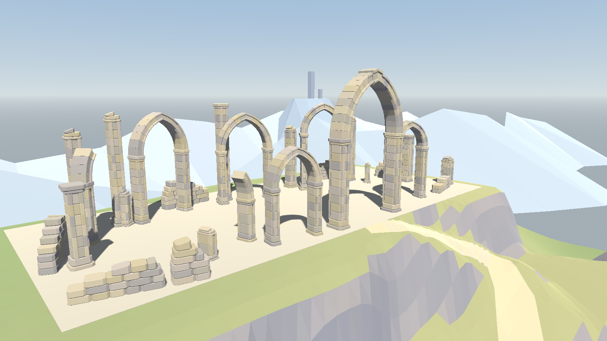

# M10 工程03-A　山頂の石造遺跡

2026-11-09。工程02・02-RはユーザーのF6手動確認により正式完了。工程03-Aは実装・実描画検証を実施し、山頂のデザイン受入待ち。開始時のHEADは `0bd8a8c`。開始時点でEffekseerのWindows用一時DLL（ファイル名がチルダで始まるもの）は削除状態だった。入力原画とリポジトリの原画のSHA-256は一致した。[参考原画](../assets/source/concepts/wind_hills_scale_reference.png)

## 山頂に到着したときの姿



広場は61.5×27m。街道の終点Eは世界座標(36.825, 45, −180)m。配置データ1単位を0.75mとして、広場の上に幅59.73m・奥行23.93m・最大高18.05mの建築を置いた。寸法は床板を除く描画メッシュの世界座標での外接箱。中央のアーチはEから東3m・北2.25mに位置し、柱身の間は約9m。内側の先端は広場から約16.4m上にある。

- **アーチ9区画**　中央1基と周囲の5基には開口部全体が残る。3区画では片側の支柱が途中で折れ、反対側に曲線の断片が残る。中央は片側11個、周辺の完存部は片側7個の扇形石で尖頭曲線を構成した。中央の頂部2石は前後と下に張り出す。縁取りとその間の溝は同一断面で造形した。
- **独立柱8本**　前後に付け柱を持つ面取りした石柱を、張り出す二段の基壇に載せた。高さと断面が途中で変わる。5本の柱頭には片側だけ残った石と傾く割れ面を設けた。
- **外壁7断片**　各段で積石の長さを変え、上へ行くほど片側が欠ける輪郭とした。上端には傾きの異なる割れ面がある。基礎は広場の既存支持面と同じ高さにある。

固定構図では、街道の先にある中央の高い開口と、左右に低くなる石造の輪郭が原画と対応する。斜めから見ると、手前のアーチの内側に奥の列柱が現れる。原画に比べると柱間が整然としており、床の石張りや石肌の水彩のにじみはまだ見えない。通常プレイでは足元を見る画角なので、アーチ直下で自然に見えるのは主人公・柱の根元・床に落ちるアーチの影。建築全体の高さは下の正面・斜めのレビュー画像で確認できる。

| 比較・レビュー | Godotの実画面 |
|---|---|
| 入口からの固定構図 | [変更前](images/m10_rebuild/03a/before_fixed.png) ／ [変更後](images/m10_rebuild/03a/fixed.png) |
| 山頂建築 | [正面](images/m10_rebuild/03a/front.png) ／ [斜め](images/m10_rebuild/03a/oblique.png) ／ [柱・破断面・壁の詳細](images/m10_rebuild/03a/masonry.png) |
| 通常プレイカメラ・到着 | [最後の石段](images/m10_rebuild/03a/stairs.png) ／ [広場入口](images/m10_rebuild/03a/entrance.png) ／ [中央アーチ直下](images/m10_rebuild/03a/under.png) |
| 通常プレイカメラ・広場内 | [回廊内部](images/m10_rebuild/03a/aisle.png) ／ [奥から入口を見る](images/m10_rebuild/03a/reverse.png) ／ [広場を横に見渡す](images/m10_rebuild/03a/across.png) |

固定比較は工程02-Rで撮影した原寸PNGを変更前の記録として使い、同じcomparisonシーンを再描画した。1672×941、透視、位置(0, 43.5, 63.75)、ピッチ−17°、縦FOV48°、共通照明。縦横2ピクセルおきにRGBの絶対差合計18超を調べたところ、該当2,066サンプルは左上を原点として(x=866～1130, y=54～138)の山頂建築部分に収まった。

## 生成・探索・衝突

山頂専用の生成器は初期化時に既存の9・8・7件の配置データを読み、決まったシードで石色・目地・欠けを作る。描画は部材ごとに頂点をまとめた単一面のメッシュ。色はクリーム、灰褐色、暖灰色などの頂点色で、材質は生成器に外から渡す。階段・橋・入口門は元の生成処理を使う。

山頂はアーチの左右支柱と上部で27組、独立柱8組、壁7組の計42個の静的衝突形状。山頂の描画メッシュは床板込み43個。フィールドの起動時は描画メッシュ567個、静的衝突540個。石の溝や小さな欠けには個別の衝突を設けず、支柱・曲線・壁段を連続した簡略形状で覆う。各衝突体が対応する描画メッシュを所有するため、既存の方式Bカメラが柱単位でフェードして復元できる。

実Playerで広場入口から中央アーチを通り、東側・奥側・西側を巡って街道に戻る89.6mを歩いた。離床・強制復帰は0。支柱・独立柱・壁の33か所で実支持面の高さと衝突を確認し、中央アーチの東柱と前面の壁には主人公を歩かせて停止を確認した。山頂のQ/E、主街道全幅、見晴らし台と川、両岸からの落水、場外復帰後の再落水、連撃・帰還の固定カメラも含め、物理診断480項目が合格。ヘッドレス戦闘試験終了時には従来と同様にResource解放警告が出た。[物理診断](measurements/m10_rebuild_03a_physics.json)

M02移動、M03ジャンプ、M04カメラ・遮蔽、M06踏み込み、M07連撃と選択、M08防御・帰還、M09起動・戦闘・AI予算、旧M10探索の13試験が合格した。[既存回帰](measurements/m10_rebuild_03a_regression_results.json)

## 実描画の性能（2026-11-09～10）

Godot 4.7.2、GeForce GTX 1080、OpenGL Compatibility、1672×941、物理60 Hz。FPSは上限を設定した実描画の平均。Frameは描画間隔、PhysicsはGodotの物理処理時間モニターを読んだ値で、ともにミリ秒。生成はフィールド初期化1回分の秒数。

| 動作・版 | 上限 | 平均FPS | Frame p95 / 最大 ms | Physics p95 / 最大 ms | 生成 秒 |
|---|---:|---:|---:|---:|---:|
| 全ルート・[02-R](measurements/m10_rebuild_02r_route_60.json) | 60 | 60.00 | 16.856 / 19.035 | 1.371 / 2.998 | 2.307 |
| 全ルート・[03-A](measurements/m10_rebuild_03a_route_60.json) | 60 | 60.00 | 16.812 / 18.685 | 1.271 / 3.174 | 4.048 |
| 全ルート・[02-R](measurements/m10_rebuild_02r_route_30.json) | 30 | 30.00 | 33.730 / 35.978 | 2.637 / 2.877 | 3.658 |
| 全ルート・[03-A](measurements/m10_rebuild_03a_route_30.json) | 30 | 30.00 | 33.515 / 35.219 | 0.864 / 2.581 | 3.471 |
| 山頂回転・[旧版再測定](measurements/m10_rebuild_03a_prior_60.json) | 60 | 60.00 | 16.786 / 18.177 | 4.542 / 4.542 | 2.502 |
| 山頂回転・[03-A](measurements/m10_rebuild_03a_profile_60.json) | 60 | 60.00 | 16.881 / 18.065 | 3.526 / 3.526 | 3.293 |
| 山頂回転・[旧版再測定](measurements/m10_rebuild_03a_prior_30.json) | 30 | 30.00 | 33.529 / 34.662 | 3.420 / 3.420 | 3.380 |
| 山頂回転・[03-A](measurements/m10_rebuild_03a_profile_30.json) | 30 | 30.00 | 34.110 / 34.602 | 4.019 / 4.402 | 3.809 |

全ルートは旧版の工程02-Rの記録と比較した。03-Aの60 FPSは277項目、30 FPSは271項目に合格し、歩行中の離床はともに0。30 FPS試走の一部は別の検証と並行したため、単独測定との小差から速度の向上は判断できない。

山頂回転は旧版と新版を同じカメラ位置・操作で各7秒、別プロセスで順番に計測した。60 FPSで画面全体の描画呼び出しは平均1,163→1,272、最大1,534→1,533。30 FPSでは平均1,165→1,271、最大1,534→1,533。新しい柱による遮蔽フェード中のフレームは60 FPSで108→197（420回中）、30 FPSで54→98（210回中）。いずれも主人公が画面外に出た回数は0で、柱を離れた後にフェードが解除された。メッシュ・衝突形状の個数は新旧で同数。平均描画呼び出しは約9%増え、山頂回転のFrame p95は60 FPSで0.095 ms、30 FPSで0.581 ms増えた。

同条件の山頂検証で初期生成は旧版に比べて0.43～0.79秒長かった。各条件1回の測定で、長時間プレイや別のGPUでの性能は未確認。通常の探索シーン単体も実描画で起動し、初期生成は2.712秒だった。

## F6でのデザイン確認

[playground.tscn](../scenes/maps/wind_hills_rebuild/playground.tscn)をF6で起動する。最後の石段から中央の大アーチへ入り、左右の柱の間を抜けて奥から入口を振り返る。確認したい点は中央アーチの高さ、左右の破損量、奥列の読みやすさ、柱が手前に来たときの見やすさ。工程03-Bはユーザーのデザイン承認と次の指示待ち。

## 変更箇所・再実行

- [山頂の生成器](../scripts/maps/wind_hills_rebuild/summit_masonry.gd)と[フィールドへの接続](../scripts/maps/wind_hills_rebuild/field.gd)。配置JSON、プレイヤー、共有カメラ、戦闘、既存マップのソースは従来のまま。
- [山頂の撮影・診断](../tests/m10_rebuild_03a.gd)、[全ルート試走の保存先](../tests/m10_rebuild_exploration.gd)、[既存回帰の実行](../tools/validate_m10_rebuild.ps1)。工程03-Aの測定は専用名で保存する。
- [制作指示](../AGENTS.md)、[進捗](DEVELOPMENT_STATUS.md)、[テスト計画](12_TEST_PLAN.md)、本監査、実画面・測定JSON。

リポジトリ直下のPowerShellで以下を実行する。旧版の山頂回転を比較する場合は、先に旧生成スクリプトを作業用フォルダーへ展開する。

```powershell
$engine = 'D:/Game/Godot/Godot_v4.7.2-stable_win64_console.exe'
& $engine --headless --fixed-fps 60 --path . --script res://tests/m10_rebuild_03a.gd -- --physics
& $engine --resolution 1672x941 --path . --script res://tests/m10_rebuild_03a.gd
./tools/validate_m10_rebuild.ps1 -Mode 03a_regression
& $engine --path . --script res://tests/m10_rebuild_exploration.gd -- --03a
& $engine --path . --script res://tests/m10_rebuild_exploration.gd -- --03a --30
git show 0bd8a8c:scripts/maps/wind_hills_rebuild/field.gd | Set-Content .godot/m10_03a_original_field.gd -Encoding utf8
& $engine --resolution 1672x941 --path . --script res://tests/m10_rebuild_03a.gd -- --profile --prior
& $engine --resolution 1672x941 --path . --script res://tests/m10_rebuild_03a.gd -- --profile
```

最後の2コマンドは末尾に `--30` を追加すると30 FPSで測定する。
